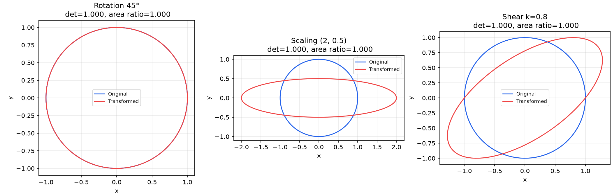
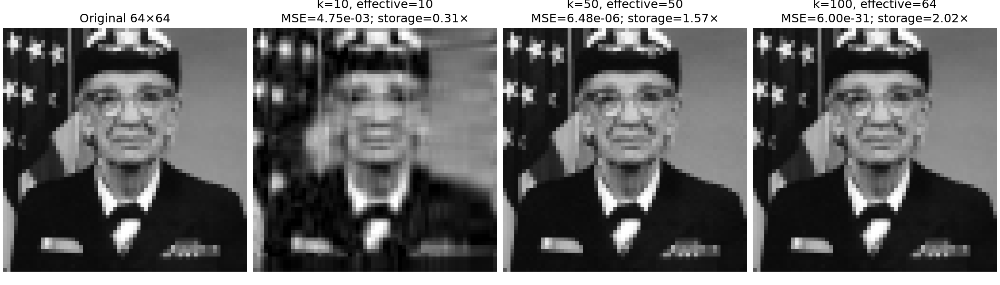
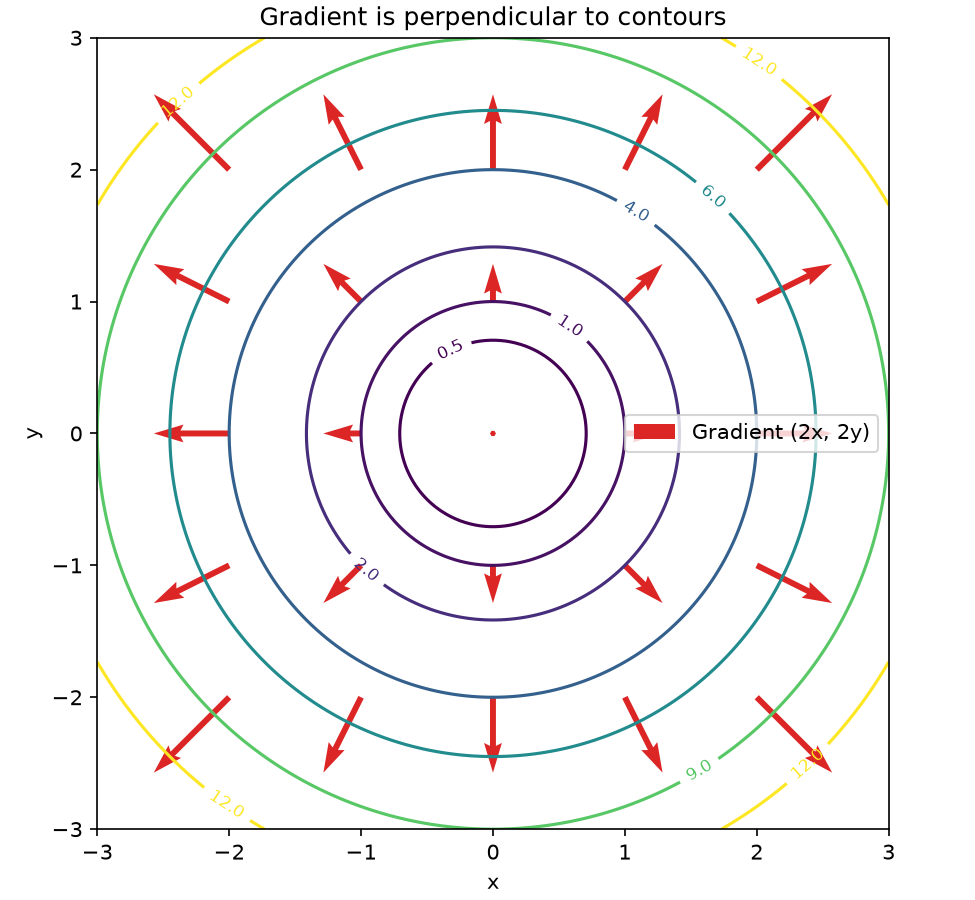
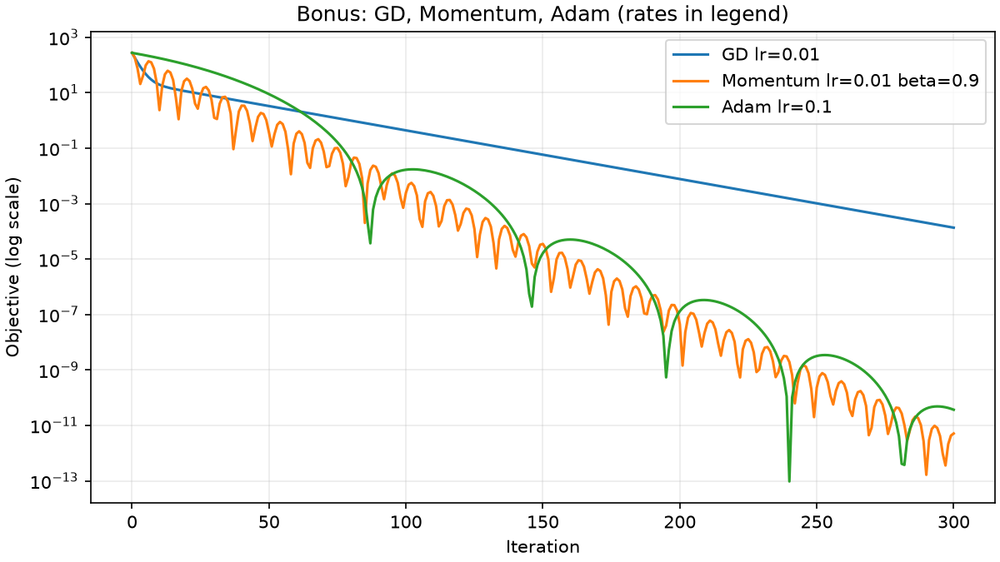

# A2-1 · AI가 어떻게 학습하는지 수학으로 직접 풀어보기

선형대수, 미분, 역전파, 최적화, 확률을 **NumPy로 직접 구현**하고 수식과
실험으로 연결하는 AI 수학 심화 과제다. 필수 결과물과 Adam, Newton,
정보 이론의 세 가지 보너스를 포함한다.

**제출 URL: https://github.com/bangahee/A2-1**

## 1. 설치

Python **3.12 이상**을 사용한다. 고정 의존성 조합이 Python 3.12 이상을
필요로 하며, 로컬 검증 환경은 Python 3.14.5다. 과제의 Python 3.8 이상
조건을 만족하는 버전이다. NumPy는 모든 수학 계산, Matplotlib은 시각화/
이미지 입출력에 사용한다. Jupyter 패키지는 노트북 실행용 개발 도구다.

처음 내려받을 때:

~~~bash
git clone https://github.com/bangahee/A2-1.git
cd A2-1
python3 --version
python3 -m venv .venv
source .venv/bin/activate
python -m pip install -r requirements-dev.txt
git config core.hooksPath .githooks
~~~

Windows에서는 가상환경 활성화 명령을 .venv\Scripts\Activate.ps1로 바꾼다.
이후 모든 명령은 A2-1 저장소 루트에서 실행한다.

## 2. 스스로 전체 검증하기

~~~bash
source .venv/bin/activate
python -m unittest discover -s tests -v
python -m scripts.run_all
python -m scripts.execute_notebooks
python -m scripts.verify_submission
python -m scripts.check_conventions
~~~

| 명령 | 기대 결과 |
|---|---|
| unittest | Ran 39 tests / OK |
| run_all | All 16 acceptance checks passed |
| execute_notebooks | backprop_derivation 4개, probability_loss 6개 code cell PASS |
| verify_submission | 12 PNGs, 16 acceptance checks, 2 executed notebooks |
| check_conventions | 모든 실제 커밋과 브랜치 규칙 PASS |

검증 실패 시 명령은 0이 아닌 종료 코드를 반환한다. 체크인한 이미지
데이터를 사용하므로 설치 후 일반 실행에는 네트워크 접근이 필요 없다.

macOS에서는 다음 명령으로 결과 그림을 연다.

~~~bash
open outputs
~~~

두 ipynb는 GitHub의 notebooks 폴더 또는 VS Code의 노트북 편집기에서 읽는다.
실행 결과가 저장되어 웹에서도 수식, 코드, 출력을 확인할 수 있다.
직접 셀을 실행하려면 편집기에서 이 저장소의 .venv 커널을 선택한다.

다음은 원본 이미지 전처리와 노트북 문서 자체를 재생성할 때만 사용한다.
build_notebooks는 노트북을 다시 작성하여 기존 편집/출력을 덮어쓴다.

~~~bash
python -m scripts.prepare_image
python -m scripts.build_notebooks
python -m scripts.execute_notebooks
~~~

## 3. 주요 결과

| 항목 | 실제 결과 | 요구 기준 |
|---|---|---|
| 면적비와 행렬식 절댓값 | 최대 상대오차 약 6.7e-16 | 1% 이내 |
| Power Iteration | λ=4.6180339887, 36회, eig 대비 상대오차 0 | 5% 이내 |
| 중심차분: f=x², x=3 | 6.0000000000393, 오차 약 3.93e-11 | 1e-4 이내 |
| 고정 신경망 출력/BCE | 0.6472915700 / 0.4349584369 | 손계산과 4자리 일치 |
| 전체 파라미터 gradient check | 최대 절대오차 약 3.7e-12 | 추가 검증 1e-7 이내 |
| GD, lr=0.1, 100회 | 원점까지 거리 약 1.44e-9 | 반경 0.1 이내 |
| softmax([1000,1001,1002]) | 합=0.9999999999999999 | 합 오차 1e-6 이내 |
| 타원형, 같은 lr=0.01 | 최초 반경 진입 GD 194회, Momentum 37회 | 가속 이점 관찰 |
| Newton, 타원형 이차 함수 | 1회에 원점 도달 | Hessian 기반 비교 |

플랫폼/BLAS에 따라 마지막 자릿수와 그림 파일 바이트는 달라질 수 있다.
상세값과 실행 환경은 [outputs/metrics.json](outputs/metrics.json)에 기록한다.

### 선형 변환과 압축

회전은 단위 원의 모양을 유지한다. 스케일링은 가로/세로 비율을 바꾸고,
전단은 x 좌표에 y의 배수를 더해 원을 기울인다. 면적 배율은 |det(A)|다.
Power Iteration은 반복적인 행렬-벡터 곱으로 지배적인 고유방향을 찾는다.
고유벡터의 부호가 반대여도 같은 고유방향이다.

원본은 공개 예제 사진을 회색조 64×64로 변환한 것이다. k=10은 원본
값 수의 약 31.5%로 주요 형태를 보존한다. k=50은 상세 형태를 복원하지만
인자 저장량이 원본보다 커진다. k=100은 크기 한계로 유효 k=64임을 표시한다.

### Gradient와 최적화

∇f=(2x,2y)는 가장 가파르게 증가하는 방향이며 등고선에 수직이다.
경사하강법은 이 방향의 반대로 이동한다.

Momentum은 이전 기울기를 누적하여 완만한 방향의 이동을 가속할 수 있다.
같은 lr=0.01에서 이점이 나타나지만 lr=0.09에서는 GD가 더 빨리
반경에 진입한다. 최초 진입 속도와 최종 오차는 다른 지표다.
Adam은 좌표별 보폭을 조절하며 사용한 lr=0.1을 그래프에 명시했다.

## 4. 수식 유도 노트북

- [backprop_derivation.ipynb](notebooks/backprop_derivation.ipynb):
  고정 2→2→1 네트워크, 순전파 손계산, 연쇄 법칙의 모든 필수 미분,
  단계별 shape, 편향 기울기, 4자리 검증, 중심차분 교차 검증.
- [probability_loss.ipynb](notebooks/probability_loss.ipynb):
  정규/Bernoulli 분포, 안정적인 softmax, Gaussian–MSE,
  Bernoulli–BCE, categorical–CE의 MLE 유도, Entropy/KL/CE.

## 5. 원문의 모순과 해석

1. y_true가 빠져 있으므로 참고 예제와 동일하게 1로 정했다.
2. f=x²+y²에서 lr=0.5는 한 번에 원점에 도달한다. 실제 발산은 lr>1이다.
   0.1, 0.5, 0.75, 1.0, 1.1을 모두 실험했다.
3. 64×64에서 k=100개의 특이값을 사용할 수 없어 유효 k=64로 명시했다.
4. 숨김층 두 번째 logit의 올바른 기울기는 -0.0517이다.
5. N(2,0.5)의 두 번째 인수는 분산으로 해석했다.
6. Momentum의 장점은 설정과 평가 지표에 의존한다.

근거는 [MATHEMATICAL_DECISIONS.md](docs/MATHEMATICAL_DECISIONS.md),
모든 요구사항의 파일/그림/수치 기준은
[REQUIREMENTS_CHECKLIST.md](docs/REQUIREMENTS_CHECKLIST.md)에서 확인한다.

## 6. 파일 구조

~~~text
A2-1/
├── src/
│   ├── linear_algebra.py     # 변환, 면적, Power Iteration, SVD
│   ├── calculus.py           # 중심차분, gradient 시각화
│   ├── backprop.py           # 순전파 및 명시적 역전파
│   ├── optimizer.py          # GD, Momentum, Adam, Newton, 경로 시각화
│   └── probability.py        # 분포, softmax, 정보 이론
├── notebooks/                # 필수 노트북 2개, 실행 출력 포함
├── data/                     # 64×64 회색조 NPY 및 출처
├── outputs/                  # PNG 12개, metrics.json
├── scripts/                  # 생성·실행·검증
├── tests/test_mathematics.py  # 독립 기준과 경계 사례 39개
├── docs/                     # 원문, 수학적 결정, 점검표
├── .github/workflows/        # Python 3.12/3.14 CI
├── .githooks/                # 커밋 메시지와 push 브랜치 이름 검사
├── CONTRIBUTING.md
├── requirements.txt
└── requirements-dev.txt
~~~

## 7. 브랜치와 커밋

제출 브랜치는 main, 개발 브랜치는 feat/a2-1-implementation이다.
이후 변경은 feat/, fix/, docs/ 등 작업 유형으로 시작하는 브랜치를 사용한다.
커밋은 feat: 설명, fix: 설명, docs: 설명 같은 형식을 유지한다.
규칙과 hook 설정은 [CONTRIBUTING.md](CONTRIBUTING.md)를 따른다.
main은 검증된 개발 이력을 fast-forward로 반영하고 개발 브랜치를 보존한다.

GitHub Actions는 push/PR마다 단위 테스트, 실험, 노트북 실행, 제출 구조,
커밋 규칙을 검사한다. 원격 서버의 강제 branch protection과는 별개다.
